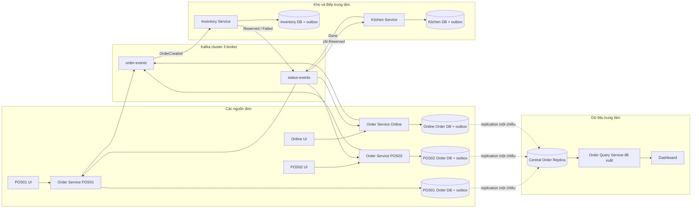
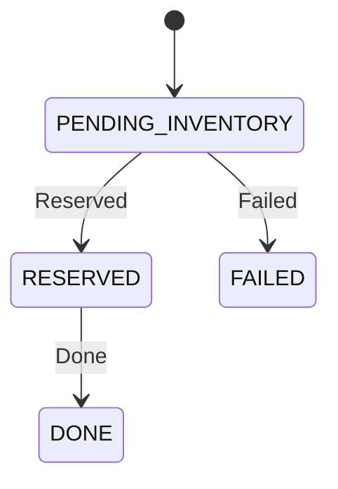

# Thiết kế chi tiết hệ thống đơn hàng POS và Online cho Bếp Kho trung tâm

Ngày lập: 30/10/2026. Phiên bản: 0.1. Trạng thái: thiết kế để triển khai và nhóm rà soát.

## 1. Mục tiêu và căn cứ

Hệ thống nhận đơn từ nhiều điểm bán POS và một kênh Online, đưa về một Kho trung tâm để xác nhận nguyên liệu, sau đó chuyển tới một Bếp trung tâm. Mỗi nguồn đơn lưu dữ liệu riêng; Kafka truyền sự kiện nghiệp vụ; dữ liệu đơn được nhân bản một chiều về trung tâm để xem tổng hợp.

Đây là đồ án môn Xây dựng hệ thống phân tán. Giá trị chính nằm ở khả năng giải thích và demo được dữ liệu nằm ở đâu, ai có quyền quyết định, điều gì xảy ra khi chạy đồng thời, mất mạng, giao trùng hoặc một thành phần dừng hoạt động. Giao diện phục vụ quan sát và thao tác các luồng này.

Căn cứ gồm tài liệu tổng hợp dự án ngày 28/10/2026 do người dùng cung cấp và các trao đổi đến ngày 30/10/2026. Chưa có đề bài hoặc rubric gốc của giảng viên trong workspace; các tiêu chí nghiệm thu dưới đây là tiêu chí kỹ thuật đề xuất của dự án, không được trình bày như yêu cầu chính thức của giảng viên.

### 1.1. Trạng thái quyết định

| Mức | Nội dung |
|---|---|
| Kế thừa từ tài liệu | Một Bếp, một Kho; DB riêng theo site/service; phân mảnh ngang đơn hàng; Kafka 3 broker; Inventory xác nhận trước Kitchen; replication bất đồng bộ một chiều về trung tâm; outbox tại các bên phát event; PostgreSQL |
| Đã xác nhận trong trao đổi | Học và triển khai từ đầu bằng Java + Spring Boot; dùng base ReactJS có sẵn; tập trung môn phân tán; không xây auth hoặc chuẩn production |
| Đề xuất triển khai v0.1 | Hai POS mẫu; Java 21; Maven; logical replication về trung tâm; schema theo nguồn; hai topic; consumer groups; API, schema và thuật toán ở tài liệu này |
| Chưa được nhóm chốt trong tài liệu nguồn | Số instance và standby DB; Order Query Service; topic/partition/config Kafka cuối cùng; cơ chế replication/failover; SLA; có làm bù trừ khi Kitchen lỗi hay không |

Tài liệu này đưa ra một phương án cụ thể cho các điểm chưa chốt để có thể bắt đầu triển khai. Việc ghi một lựa chọn vào bản v0.1 không có nghĩa nhóm đã duyệt hoặc hệ thống đã chạy được. Các phần đã thống nhất của kiến trúc nền được giữ nguyên.

### 1.2. Kết quả cần đạt

1. POS và Online tạo được đơn vào DB của chính mình.
2. Hai đơn tranh cùng nguyên liệu không làm tồn âm.
3. Đơn và event không bị tách rời khi Kafka tạm thời không khả dụng.
4. Event giao lại không làm trừ nguyên liệu hoặc tạo phiếu bếp lần thứ hai.
5. POS bị ngắt kết nối trung tâm vẫn lưu được đơn tại chỗ và gửi sau.
6. Bếp chỉ nhận đơn đã được Kho xác nhận.
7. Dữ liệu tổng hợp tại trung tâm được tái thiết từ các mảnh đơn hàng bằng replication thật.
8. Cấu hình Kafka và kịch bản thử thể hiện được khả năng phục hồi khi một broker dừng.

## 2. Phạm vi nghiệp vụ

### 2.1. Phần cần làm

| Vai trò thao tác | Chức năng tối thiểu |
|---|---|
| Nhân viên POS | Xem món; chọn số lượng; gửi đơn; xem trạng thái và lỗi kết nối |
| Người đặt Online | Chọn món; tạo đơn; xem trạng thái bằng mã đơn |
| Người quan sát Kho | Xem nguyên liệu, công thức mẫu và kết quả giữ nguyên liệu |
| Nhân viên Bếp | Xem phiếu chờ đã được Reserved; đánh dấu hoàn tất |
| Người quan sát trung tâm | Xem đơn nhiều nguồn, lọc theo nguồn/trạng thái, đếm đơn |
| Người thực hiện demo | Gửi request đồng thời, phát lại event, dừng dịch vụ và đọc log/DB để đối chứng |

Các vai trò là góc nhìn giao diện, không phải tài khoản hoặc cơ chế phân quyền. Người demo mở trực tiếp từng màn hình.

Tồn kho quản lý theo nguyên liệu. Mỗi món có công thức định lượng tại Inventory. POS và Online có danh mục món riêng nhưng dùng mã món thống nhất. Không cho người dùng sửa công thức khi đang chạy bài thử; thay dữ liệu mẫu giữa các lượt demo.

### 2.2. Ngoài phạm vi

- Đăng ký, đăng nhập, JWT, OAuth, Spring Security cho tài khoản, RBAC, quên mật khẩu.
- Thanh toán, hóa đơn thuế, khuyến mãi, khách hàng, nhà cung cấp và quy trình nhập kho.
- Sửa/hủy đơn sau khi gửi, xử lý hoàn tiền và các luồng thương mại đầy đủ.
- Redis, broker thứ hai, Kafka Connect, Kafka Streams, service mesh, Kubernetes, multi-region, multi-master và load balancer riêng.
- API Gateway, service discovery, bộ giám sát production, distributed tracing platform và CI/CD hoàn chỉnh.
- Failover PostgreSQL tự động và cam kết sống sót khi cả máy chạy demo bị tắt.
- Ứng dụng mobile native, đồng bộ giỏ hàng trình duyệt và PWA offline toàn diện.

Vẫn làm validation đầu vào, constraint DB, transaction, log và thông báo lỗi đủ để demo đúng. Các phần này trực tiếp bảo vệ tính đúng đắn của hệ thống phân tán.

### 2.3. Phần mở rộng có điều kiện

Kitchen thất bại sau Reserved và Inventory hoàn nguyên liệu đúng một lần là phần mở rộng. Chỉ triển khai sau khi ba vấn đề lõi và replication đã ổn. Khi chưa triển khai, không đưa vào màn hình như một chức năng đang có và không cam kết tự giải phóng hàng đã giữ.

## 3. Stack và cách tổ chức code

| Lớp | Lựa chọn | Vai trò |
|---|---|---|
| Frontend | Base React + JavaScript + Vite hiện có | Tái sử dụng giao diện, router, component |
| Gọi API và dữ liệu UI | Axios + TanStack Query hiện có | HTTP, cache, polling trạng thái |
| UI state | Zustand hiện có, khi cần | Giỏ món và trạng thái giao diện; không làm nguồn tồn kho |
| Backend | Java 21 + Spring Boot, bản stable tương thích khi khởi tạo | REST API, transaction, worker, Kafka consumer |
| Build | Maven Wrapper | Cùng cách build trên máy các thành viên |
| DB access | Spring Data JPA; SQL trực tiếp cho đoạn khóa/cập nhật tồn | Truy cập dữ liệu và xử lý cạnh tranh rõ ràng |
| Migration | Flyway | Tạo schema, constraint và seed có kiểm soát |
| Database | PostgreSQL | DB độc lập cho nguồn đơn, Kho, Bếp và trung tâm |
| Messaging | Apache Kafka 3 broker, đề xuất KRaft | Truyền event và thử lỗi broker |
| Replication trung tâm | PostgreSQL logical replication, đề xuất | Gom các mảnh dữ liệu đơn vào subscriber trung tâm |
| Chạy local | Docker Compose | DB, Kafka và các service; frontend có thể chạy Vite ngoài container |
| Kiểm chứng | JUnit, integration test hoặc script HTTP/Kafka và truy vấn SQL | Chứng minh các bất biến và tình huống lỗi |

Không chuyển frontend sang TypeScript chỉ để đồng nhất với đề xuất ban đầu. Chưa nâng hoặc thay dependency của base frontend trong bước lập tài liệu này. Khi khởi tạo backend, chốt chính xác version Spring Boot, PostgreSQL và Kafka vào build/Compose; không dùng image tag `latest`. Chọn dependency theo quản lý version của Spring Boot, không tự ghép ngẫu nhiên các version Spring/Kafka client.

### 3.1. Cấu trúc dự kiến

```text
distributed-order-system/
  README.md
  docs/
    PROJECT_SPEC.md
    DEMO_PLAN.md
  react-starter-kit-zq/           # base React đã có
  backend/                       # sẽ tạo khi triển khai
    pom.xml                      # Maven multi-module
    event-contracts/             # DTO/enums event tối thiểu
    order-service/               # một codebase, chạy POS01/POS02/ONLINE
    inventory-service/
    kitchen-service/
    order-query-service/         # phương án đề xuất cho truy vấn trung tâm
  infra/                         # sẽ tạo khi triển khai
    compose.yaml
    postgres/
    kafka/
  scripts/                       # seed, kiểm tra và điều khiển demo
```

Không sao chép Order Service thành ba dự án. Mỗi instance dùng cấu hình `SITE_ID`, `SOURCE_TYPE`, `DB_URL`, `DB_SCHEMA`, `KAFKA_GROUP_ID`. Chỉ chia sẻ event contract thực sự cần dùng; không dùng chung JPA entity hoặc repository giữa các service.

Trong mỗi service, bắt đầu với các package `api`, `application`, `domain`, `infrastructure`, hoặc cấu trúc đơn giản tương đương. Không bắt buộc xây framework nội bộ hay nhiều tầng chỉ để đủ tên mô hình.

## 4. Kiến trúc và quyền sở hữu dữ liệu

### 4.1. Site triển khai mẫu

| Site | Service | DB sở hữu | Ghi chú |
|---|---|---|---|
| POS01 | Order Service cấu hình POS01 | POS01 Order DB | Có thể ghi đơn khi đứt kết nối trung tâm |
| POS02 | Order Service cấu hình POS02 | POS02 Order DB | Mảnh đơn khác POS01 |
| Online | Order Service cấu hình ONLINE | Online Order DB | Cùng codebase, DB riêng |
| Kho trung tâm | Inventory Service | Inventory DB | Nơi duy nhất quyết định nguyên liệu |
| Bếp trung tâm | Kitchen Service | Kitchen DB | Phiếu bếp và trạng thái hoàn tất |
| Dữ liệu trung tâm | Order Query Service đề xuất | Central Order Replica | Query Service chỉ đọc dữ liệu tổng hợp |

Một frontend có thể chứa các route của nhiều vai trò. Số frontend không quyết định số site dữ liệu. Mỗi POS cần đường tới service và DB cục bộ của nó; việc chọn POS trên UI chỉ chọn endpoint tương ứng.

### 4.2. Luồng ở mức cao



Đây là sơ đồ kỹ thuật của bản triển khai. Khi làm HLD để nộp bài, tiếp tục dùng hình gọn và các quy ước của tài liệu nguồn; không bắt buộc đưa tên DBMS, bảng hay toàn bộ chi tiết worker lên hình.

### 4.3. Số instance theo giai đoạn

| Thành phần | Trong lúc học và làm từng bước | Cấu hình demo mở rộng đề xuất |
|---|---|---|
| Order POS | Bắt đầu POS01 ×1 | POS01 ×1, POS02 ×1 |
| Order Online | ×1 | ×2, dùng chung Online DB và consumer group |
| Inventory | ×1 | ×2, dùng chung Inventory DB và consumer group |
| Kitchen | ×1 | ×2, dùng chung Kitchen DB và consumer group |
| Query | ×1 khi làm replication | ×1 |
| Kafka | Dùng cụm 3 broker khi bắt đầu tích hợp Kafka | 3 broker |
| DB nguồn và DB nghiệp vụ | Mỗi loại một primary riêng | Giữ các DB riêng |
| Inventory/Kitchen standby | Chưa cần cho lát cắt đầu | Mỗi DB một standby nếu nhóm duyệt yêu cầu replica |

Số instance mở rộng và standby vẫn là đề xuất theo tài liệu nguồn. Giai đoạn đầu chạy ít service không được dùng làm bằng chứng đã hoàn thành bài thử nhiều instance. Nếu dùng hai instance API mà không có load balancer, UI gọi một cổng cố định; bài thử gọi trực tiếp từng cổng. Các consumer vẫn chia partition qua consumer group.

### 4.4. Ownership

- Order Service chỉ ghi DB của nguồn nó đại diện.
- Inventory chỉ ghi Inventory DB; không đọc trực tiếp DB POS/Online để lấy món.
- Kitchen chỉ ghi Kitchen DB; nhận đủ dòng món từ event Reserved.
- Query Service đọc Central Order Replica, không truy vấn xuyên sang DB nguồn lúc lập báo cáo.
- Replication là luồng hạ tầng được cấu hình rõ ràng; không cấp quyền cho service tự truy cập DB của nhau.
- Các instance cùng một service/site dùng chung DB của service/site đó; thêm instance không tự tạo thêm mảnh dữ liệu.

## 5. Luồng nghiệp vụ và trạng thái

### 5.1. Tạo và xử lý đơn

1. UI gửi danh sách `dishId`, `quantity`, `clientRequestId` đến Order Service của nguồn.
2. Order Service kiểm tra món tồn tại trong menu cục bộ, số lượng hợp lệ, gán `orderId` UUID và thông tin nguồn từ cấu hình server.
3. Trong một transaction, ghi `orders`, `order_items` và outbox chứa `OrderCreated`. Trả `201` với trạng thái `PENDING_INVENTORY` sau khi commit.
4. Worker của nguồn gửi event lên Kafka; không đợi Kho/Bếp để trả kết quả tạo đơn.
5. Inventory nhận event, tính nguyên liệu theo công thức, kiểm tra và giữ nguyên liệu trong một transaction. Ghi quyết định và outbox Reserved hoặc Failed cùng transaction.
6. Kitchen chỉ xử lý Reserved, tạo một phiếu bếp duy nhất cho mỗi đơn.
7. Nhân viên Bếp đánh dấu hoàn tất. Kitchen cập nhật phiếu và ghi outbox Done trong cùng transaction.
8. Order Service nguồn nhận Reserved/Failed/Done, cập nhật đơn của chính mình. UI polling để hiển thị kết quả.
9. PostgreSQL đồng bộ thay đổi đơn và chi tiết về Central Order Replica. Dashboard đọc bản sao qua Query Service và có thể thấy dữ liệu trễ.

### 5.2. Trạng thái tối thiểu

| Nơi lưu | Trạng thái | Ý nghĩa |
|---|---|---|
| Order DB | `PENDING_INVENTORY` | Đã lưu đơn, chưa nhận quyết định từ Kho |
| Order DB | `RESERVED` | Kho đã chấp nhận và giữ nguyên liệu |
| Order DB | `FAILED` | Kho từ chối, có mã lý do |
| Order DB | `DONE` | Bếp đã hoàn tất |
| Kitchen DB | `WAITING`, `DONE` | Đủ để demo tiếp nhận và hoàn thành phiếu |
| Inventory DB | `RESERVED`, `FAILED` | Quyết định bền vững cho từng mã đơn |



`PENDING_INVENTORY` không có nghĩa đã giữ nguyên liệu hoặc Kafka đã nhận event. Trạng thái gửi event xem ở outbox, không trộn vào trạng thái nghiệp vụ. Với phạm vi hiện tại, giữ hàng làm giảm lượng nguyên liệu khả dụng ngay; Done không trừ thêm lần nữa.

### 5.3. Event lặp và đến muộn

Khóa xử lý theo đơn bằng row lock hoặc cơ chế cập nhật có điều kiện. Reserved nhận sau Done được bỏ qua có ghi log; không đổi Done về Reserved. Failed và Done là trạng thái kết thúc trong baseline. Không dùng thời gian `occurredAt` để quyết định event mới hơn vì đồng hồ các service có thể lệch.

Đề xuất quy tắc hội tụ: Order Service cho phép `PENDING_INVENTORY -> DONE` nếu Done hợp lệ đến trước khi Reserved được áp dụng tại nguồn. Done chỉ được Kitchen tạo từ một phiếu đã nhận Reserved. Đây là đường xử lý kỹ thuật khi thông điệp đến muộn; không cho UI tự nhảy trạng thái. Event trái với trạng thái kết thúc, ví dụ Failed sau Done, phải được ghi log để điều tra, không âm thầm ghi đè.

Kafka key cùng `orderId` hỗ trợ thứ tự trong partition khi số partition giữ nguyên. Nó không biến event từ nhiều producer hoặc các lần phát lại thành một thứ tự nghiệp vụ toàn cục. Vì vậy vẫn cần quy tắc chuyển trạng thái.

## 6. Dữ liệu, phân mảnh và ràng buộc

### 6.1. Mảnh đơn hàng

Quan hệ logic `DON_HANG` được phân mảnh ngang theo `nguon_dat` và `diem_ban_id`:

```text
DON_HANG_POS01 = các đơn nguồn POS, điểm bán POS01
DON_HANG_POS02 = các đơn nguồn POS, điểm bán POS02
DON_HANG_ONLINE = các đơn nguồn ONLINE
DON_HANG = DON_HANG_POS01 UNION ALL DON_HANG_POS02 UNION ALL DON_HANG_ONLINE
```

- Đầy đủ: mỗi đơn thuộc một nguồn được hỗ trợ đều có đúng một nơi lưu.
- Tách biệt: server gán nguồn và điểm bán cố định; constraint kiểm tra đúng nguồn/site; một đơn không ghi đồng thời vào hai mảnh gốc.
- Tái thiết được: các mảnh có cùng cấu trúc và có thể hợp lại. Bản sao tại trung tâm không phải mảnh gốc mới.

Phân mảnh này được triển khai bằng các DB riêng. Không cần thêm PostgreSQL table partitioning để gọi đây là phân mảnh ngang của hệ thống. Chi tiết đơn được đặt cùng site với đơn cha.

### 6.2. Các bảng chính

| DB | Bảng | Trường và ràng buộc cốt lõi |
|---|---|---|
| Mỗi Order DB | `menu_items` | `dish_id` PK, `name`, `active`; seed cùng quy ước mã món |
| Mỗi Order DB | `orders` | `order_id` UUID PK, `client_request_id` UNIQUE, `source_type`, `site_id`, `status`, `failure_reason`, `version`, `created_at`, `updated_at` |
| Mỗi Order DB | `order_items` | PK `(order_id, line_no)`, FK đơn, `dish_id`, `dish_name_snapshot`, `quantity > 0` |
| Mỗi Order DB | `processed_events` | `event_id` PK, `order_id`, `processed_at`; đi cùng transaction cập nhật trạng thái |
| Inventory DB | `ingredients` | `ingredient_id` PK, `name`, `unit`, `available_quantity >= 0` |
| Inventory DB | `recipe_items` | PK `(dish_id, ingredient_id)`, `quantity_per_dish > 0` |
| Inventory DB | `inventory_order_decisions` | `order_id` PK, `source_site_id`, `request_fingerprint`, `decision`, `reason`, timestamps |
| Inventory DB | `reservation_items` | PK `(order_id, ingredient_id)`, FK quyết định, `reserved_quantity > 0` |
| Inventory DB | `processed_events` | `event_id` PK; chống xử lý lại cùng event |
| Kitchen DB | `kitchen_tickets` | `ticket_id` PK, `order_id` UNIQUE, `source_site_id`, `status`, timestamps |
| Kitchen DB | `kitchen_ticket_items` | PK `(ticket_id, line_no)`, mã món, tên snapshot và số lượng |
| Kitchen DB | `processed_events` | `event_id` PK; ghi cùng transaction tạo phiếu |
| Các DB phát event | `outbox_events` | `event_id` UUID PK, `aggregate_id`, `event_type`, `topic`, `message_key`, `payload` JSONB, `created_at`, `sent_at`, `attempt_count`, `next_attempt_at` |

Dùng UUID cho mã đơn và event để các nguồn không cần xin một bộ cấp số trung tâm. `client_request_id` chống tạo hai đơn khi trình duyệt gửi lại cùng yêu cầu do mất phản hồi HTTP; cùng request ID nhưng nội dung khác trả `409`. Mỗi lần đặt đơn mới phải tạo request ID mới.

Định lượng dùng số nguyên theo đơn vị nhỏ nhất, ví dụ gram và ml, hoặc `NUMERIC` nếu cần phần lẻ. Không dùng floating point cho phép tính tồn. Trong demo, công thức cố định và dữ liệu seed hợp lệ. Không cần bảng khách hàng hoặc thanh toán.

### 6.3. Giữ nguyên liệu nguyên tử

Thuật toán đề xuất cho mỗi OrderCreated:

1. Mở transaction tại Inventory DB.
2. Chèn `processed_events` bằng `INSERT ... ON CONFLICT DO NOTHING RETURNING`. Nếu event đã tồn tại, kết thúc thành công mà không đổi tồn.
3. Chèn bản ghi quyết định theo `order_id` với trạng thái nội bộ `PROCESSING` bằng `ON CONFLICT DO NOTHING`. Unique key bảo đảm chỉ một transaction thắng cho đơn đó. Nếu đã có quyết định hoàn chỉnh, đối chiếu nội dung và kết thúc, không giữ lại. `PROCESSING` phải được cập nhật thành Reserved/Failed trước commit, không để tồn tại sau một transaction thành công.
4. Cộng gộp nhu cầu nguyên liệu của tất cả dòng món, kể cả các món dùng chung nguyên liệu.
5. Khóa toàn bộ hàng nguyên liệu cần dùng bằng `SELECT ... ORDER BY ingredient_id FOR UPDATE`. Các transaction dùng cùng thứ tự khóa để giảm deadlock.
6. Kiểm tra toàn bộ nguyên liệu trước khi cập nhật. Nếu thiếu công thức hoặc thiếu nguyên liệu, ghi Failed và outbox Failed, không trừ bất kỳ nguyên liệu nào.
7. Nếu đủ, cập nhật từng nguyên liệu với điều kiện `available_quantity >= required`, kiểm tra số hàng cập nhật; ghi `reservation_items`, quyết định Reserved và outbox Reserved.
8. Commit DB; sau đó mới cho Kafka consumer commit/ack offset.

Nếu một cập nhật bất ngờ không thành công sau khi đã bắt đầu trừ, rollback toàn bộ transaction rồi retry; không commit trạng thái Failed kèm một phần nguyên liệu đã trừ. Lỗi thiếu nguyên liệu thông thường là quyết định nghiệp vụ được commit, không phải exception làm rollback mất event Failed.

Hai instance Inventory dùng cùng Inventory DB nên khóa và constraint có hiệu lực giữa hai process. Không dùng `synchronized`, mutex trong RAM hoặc Redis làm cơ chế bảo vệ tồn kho. Isolation mặc định Read Committed có thể dùng cho thuật toán khóa hàng này; tính đúng đắn đến từ phạm vi transaction, row lock và điều kiện cập nhật, không phải chỉ từ nhãn isolation.

### 6.4. Idempotency theo nghiệp vụ

Chỉ chống trùng `event_id` chưa đủ: một lỗi producer có thể tạo event ID khác cho cùng mã đơn. Vì vậy Inventory còn unique `order_id`, Kitchen unique `order_id`, và thao tác hoàn tất chỉ chuyển phiếu `WAITING -> DONE` đúng một lần. Với cùng mã đơn nhưng payload khác, ghi lỗi dữ liệu để xử lý; không coi là một yêu cầu mới để trừ tồn tiếp.

Không bắt exception unique constraint rồi tiếp tục ghi trong một transaction PostgreSQL đã lỗi. Dùng `ON CONFLICT` hoặc đường xử lý transaction riêng phù hợp.

## 7. Transactional outbox và giao nhận sự kiện

### 7.1. Những nơi cần outbox

| Bên phát | Cùng transaction với | Event |
|---|---|---|
| Order Service mỗi nguồn | Tạo đơn và dòng món | OrderCreated |
| Inventory | Quyết định và thay đổi tồn | Reserved hoặc Failed |
| Kitchen | Đánh dấu phiếu hoàn tất | Done |

Không gửi Kafka như một thao tác bắt buộc trong API tạo đơn. Transaction PostgreSQL không tự bao trùm Kafka; thêm `@Transactional` vào hàm vừa ghi DB vừa gửi Kafka không thay thế outbox.

### 7.2. Worker tối thiểu

Mỗi service có scheduled worker. Đề xuất quét mỗi 500 ms khi khỏe. Mỗi lượt xử lý tối đa một số ít event, mỗi event có transaction ngắn riêng:

1. Lấy một bản ghi đến hạn, chưa gửi, với thứ tự khóa: `ORDER BY created_at, event_id LIMIT 1 FOR UPDATE SKIP LOCKED`.
2. Giữ khóa bản ghi trong transaction để hai instance không cùng nhận dòng outbox đó.
3. Gửi payload đã lưu với cùng event ID và key; chờ producer nhận acknowledgment, có timeout hữu hạn.
4. Thành công thì ghi `sent_at` và commit.
5. Kafka lỗi thì giữ trạng thái chưa gửi, cập nhật số lần thử và lịch thử tiếp, ví dụ backoff tối đa 10 giây. Nếu lỗi DB, rollback.

Giữ row lock trong lúc chờ Kafka là đánh đổi đơn giản cho demo, không phải thiết kế tối ưu throughput. Timeout gửi và số event mỗi lượt phải hữu hạn. Cần đo và đặt `max.poll.interval.ms` phù hợp cho consumer; worker outbox không chạy bên trong listener xử lý nghiệp vụ.

Khi dùng Spring proxy transaction, scheduled method nên gọi method transactional trên bean khác hoặc dùng `TransactionTemplate`; không giả định gọi nội bộ một method có annotation là transaction đã có hiệu lực.

### 7.3. Các cửa sổ lỗi phải hiểu

| Thời điểm lỗi | Hệ quả và cách phục hồi |
|---|---|
| Trước khi transaction nghiệp vụ commit | Đơn/thay đổi tồn và outbox cùng rollback |
| DB đã commit, Kafka chưa nhận | Outbox còn; worker gửi lại |
| Kafka đã nhận nhưng worker chết trước khi lưu `sent_at` | Worker sẽ gửi lại cùng event; consumer phải idempotent |
| Consumer commit DB rồi chết trước khi commit offset | Kafka có thể giao lại; DB dedup ngăn tác dụng phụ lần hai |
| Consumer lỗi trước commit DB | Transaction rollback; offset không được vượt record chưa xử lý |

Cam kết thiết kế là giao nhận ít nhất một lần và tác dụng nghiệp vụ được chống trùng trong phạm vi đã nêu. Không tuyên bố exactly-once xuyên toàn hệ thống chỉ vì bật producer idempotence.

## 8. Kafka và event contract

### 8.1. Topic và key đề xuất

| Topic | Event | Key | Partition đề xuất |
|---|---|---|---|
| `order-events` | `OrderCreated` | `orderId` | 3 |
| `status-events` | `Reserved`, `Failed`, `Done` | `orderId` | 3 |

Partition 3 là lựa chọn nhỏ để thử hai consumer instance; không phải kết quả tính toán tải. Giữ nguyên số partition trong các lượt thử thứ tự event. Không tạo topic riêng cho từng đơn hoặc tự thêm broker khác.

### 8.2. Consumer group

| Consumer | Topic | Group đề xuất | Hành vi |
|---|---|---|---|
| Inventory instance 1 và 2 | order-events | `inventory-v1` | Chia công việc; mỗi event vào một instance trong group |
| Kitchen instance 1 và 2 | status-events | `kitchen-v1` | Cùng group; chỉ Reserved tạo phiếu; Failed/Done được bỏ qua đúng cách |
| POS01 Order Service | status-events | `order-status-pos01-v1` | Chỉ áp dụng event có sourceSiteId POS01 |
| POS02 Order Service | status-events | `order-status-pos02-v1` | Chỉ áp dụng event có sourceSiteId POS02 |
| Online Order instance 1 và 2 | status-events | `order-status-online-v1` | Cùng group vì dùng chung Online DB |

Không cho mọi POS dùng chung một group rồi lọc site: event có thể bị một POS khác nhận và bỏ qua, làm nguồn thật không bao giờ cập nhật. Các site khác nhau cần group khác nhau trong phương án hai topic này. Event không thuộc site hoặc type cần xử lý được bỏ qua có chủ đích và tiến offset; event của chính site chỉ tiến offset sau khi DB commit.

### 8.3. Cấu hình độ tin cậy đề xuất

- Topic replication factor `3`, `min.insync.replicas=2`.
- Producer `acks=all`, `enable.idempotence=true`; giữ các cấu hình liên quan tương thích theo tài liệu Kafka.
- Consumer tắt auto commit; chọn chế độ acknowledgment theo record sau commit DB, không commit trước nghiệp vụ.
- Các topic nội bộ cần replication/quorum phù hợp; cấu hình KRaft để cụm chịu được mất một node trong mô hình 3 node.
- Khai báo topic bằng script hoặc AdminClient có thể chạy lại; kiểm tra cấu hình thực tế trước demo.
- Retention phải dài hơn thời gian demo/ngắt kết nối; không hứa phục hồi nếu event đã hết retention hoặc dữ liệu DB/volume bị xóa.

Mục tiêu chịu lỗi một broker cần thử thật: chờ ISR và quorum khỏe trước khi tắt, đo thời gian bầu leader và phục hồi. Hai broker mất có thể làm dừng ghi với cấu hình này; đơn vẫn lưu ở outbox khi DB nguồn còn hoạt động. Không nhầm broker replication với standby PostgreSQL.

### 8.4. Envelope và payload

```json
{
  "eventId": "5ffac880-b377-43d2-ae6c-3c5df8805a63",
  "schemaVersion": 1,
  "eventType": "OrderCreated",
  "orderId": "d967e06a-090d-4abc-9fb2-c5ec54306e08",
  "sourceType": "POS",
  "sourceSiteId": "POS01",
  "occurredAt": "2026-10-30T02:00:00Z",
  "payload": {
    "items": [
      { "lineNo": 1, "dishId": "COM_GA", "dishName": "Cơm gà", "quantity": 2 }
    ]
  }
}
```

| Type | Payload tối thiểu bổ sung |
|---|---|
| OrderCreated | `items` gồm mã món, tên snapshot và số lượng |
| Reserved | `reservationId` (có thể dùng orderId), `items` đủ cho Kitchen |
| Failed | `reasonCode`, `reasonMessage`; ví dụ `INSUFFICIENT_INGREDIENT`, `RECIPE_NOT_FOUND` |
| Done | `ticketId`, `completedAt` |

Mỗi sự kiện nghiệp vụ mới có event ID mới; retry một sự kiện giữ nguyên ID và payload. `sourceSiteId` luôn xác định được nơi trả trạng thái. Dùng JSON và schemaVersion; chưa cần Schema Registry. Validate contract tại consumer, log rõ lỗi và không biến event hỏng thành một đơn đã xử lý thành công.

### 8.5. Lỗi consumer

Lỗi thiếu nguyên liệu tạo Failed bình thường. Lỗi DB/mạng tạm thời retry và không commit record chưa xử lý. Với JSON/schema hỏng hoặc lỗi lập trình lặp lại, đề xuất retry hữu hạn rồi dừng listener/container và báo lỗi rõ; người demo kiểm tra, sửa nguyên nhân và khởi động lại. Phải cấu hình error handler rõ ràng để không tự recover rồi âm thầm bỏ record. Chưa cần DLT hoặc bộ điều phối retry riêng cho baseline.

## 9. Replication và truy vấn trung tâm

### 9.1. Tách hai mục đích nhân bản

| Luồng | Mục đích | Phương án |
|---|---|---|
| POS/Online tới Central Order Replica | Gom các mảnh để truy vấn và báo cáo | Logical replication một chiều, bất đồng bộ, đề xuất |
| Inventory/Kitchen primary tới standby | Bản sao dự phòng của riêng DB đó | Streaming replication bất đồng bộ nếu nhóm duyệt phần standby |

Central Order Replica không phải primary chung và không quyết định tồn kho. Nhiều publisher gửi các mảnh tách biệt về một subscriber không phải multi-master trên cùng một mảnh. Streaming standby của Kho/Bếp không thay thế bản tổng hợp đơn hàng.

### 9.2. Bố trí bảng cho logical replication

PostgreSQL logical replication ánh xạ theo tên đầy đủ schema + table và không tự replicate DDL. Vì vậy đề xuất cách bố trí sau để tránh các nguồn cùng ghi vào một bảng đích:

| DB nguồn | Bảng nguồn | Bảng tại Central |
|---|---|---|
| POS01 DB | `pos01.orders`, `pos01.order_items` | `pos01.orders`, `pos01.order_items` |
| POS02 DB | `pos02.orders`, `pos02.order_items` | `pos02.orders`, `pos02.order_items` |
| Online DB | `online.orders`, `online.order_items` | `online.orders`, `online.order_items` |

Mỗi nguồn chỉ có schema của nó và constraint nguồn/site cố định. Order Service dùng default schema từ cấu hình, không lấy tên schema từ input của người dùng. Trung tâm tạo sẵn cả ba schema và các bảng tương thích bằng migration trước khi tạo subscription.

Mỗi nguồn có một publication gồm orders và order_items; trung tâm có ba subscription, mỗi subscription chỉ nhận publication của một nguồn. Mỗi bảng có PK để replicate UPDATE/DELETE. Không replicate outbox, menu, inbox hoặc bảng Kho/Bếp trong luồng tổng hợp này.

View logic tại trung tâm:

```sql
CREATE VIEW reporting.all_orders AS
SELECT * FROM pos01.orders
UNION ALL
SELECT * FROM pos02.orders
UNION ALL
SELECT * FROM online.orders;
```

Khi triển khai, dùng danh sách cột tường minh thay vì `SELECT *` để kiểm soát thay đổi schema. Tạo view tương tự cho chi tiết đơn. Query Service dùng DB user chỉ có SELECT; replication worker có quyền riêng để áp dụng dữ liệu. Không đặt toàn bộ subscriber ở chế độ cấm ghi khiến replication worker không hoạt động.

### 9.3. Cách khởi tạo và kiểm chứng

1. Bật `wal_level=logical` ở các publisher; cấp replication role và cấu hình số slot/walsender đủ cho subscriptions và initial sync.
2. Tạo schema/bảng ở nguồn và trung tâm; chuẩn bị migration tương thích.
3. Tạo publication/subscription, chờ initial copy hoàn tất rồi mới đo độ trễ.
4. Tạo đơn tại từng nguồn, đối chiếu mã đơn, dòng món và trạng thái ở trung tâm.
5. Tạm dừng một subscription, tạo/cập nhật đơn, quan sát nguồn tiếp tục hoạt động và trung tâm chậm lại; bật subscription rồi kiểm tra hội tụ.
6. Theo dõi replication slot/WAL trong demo; không để subscription bị ngắt vô thời hạn hoặc xóa volume nguồn rồi gọi đó là bài thử mất mạng.

Các nguồn khác nhau có thể đến trung tâm ở các thời điểm khác nhau; không có snapshot toàn chuỗi đồng thời. Trung tâm không được dùng để xác nhận nguyên liệu hoặc trả lời chắc chắn trạng thái mới nhất khi nguồn đang offline. UI ghi rõ dữ liệu có thể trễ, không hiển thị thời gian fetch API như thời gian đã đồng bộ hoàn toàn.

### 9.4. Standby Kho và Bếp

Nếu nhóm giữ phương án primary + standby, triển khai thêm hai PostgreSQL standby và kiểm tra dữ liệu được replay. Không tự thêm HA manager. Khi primary chết, baseline thừa nhận service tương ứng tạm dừng; standby bất đồng bộ có thể trễ. Có replica không đồng nghĩa đã có automatic failover hoặc không mất dữ liệu. Phần promote thủ công chỉ đưa vào demo nếu có quy trình riêng được kiểm chứng và primary cũ được cách ly.

## 10. Mất mạng và mô hình nhất quán

### 10.1. Phương án POS offline

Offline trong bài này nghĩa là mất kết nối từ site POS tới Kafka/trung tâm, trong khi trình duyệt hoặc máy POS vẫn truy cập được Order Service và PostgreSQL tại chỗ. Đơn mới được lưu `PENDING_INVENTORY` cùng outbox. Khi nối lại, worker gửi các event đang chờ; Inventory quyết định đủ/thiếu rồi Bếp mới xử lý.

Không demo offline bằng cách tắt chính Order Service hoặc DB POS rồi vẫn tuyên bố API tạo đơn thành công. Nếu trình duyệt không gọi được service cục bộ, giao diện phải báo lỗi; chưa có cơ chế browser-only để nhận đơn. Muốn tải lại UI khi WAN mất thì frontend POS cũng phải được phục vụ tại chỗ hoặc đã có bản build local; một màn hình đang mở chưa chứng minh tải lại được khi mất mạng.

Trong Compose, tách đường mạng POS với trung tâm khỏi đường service-to-local-DB để ngắt đúng kết nối. Bài thử mất mạng POS phải cắt cả hướng Kafka và replication của site đó nếu tuyên bố POS bị cô lập hoàn toàn khỏi trung tâm. Các đường truyền đang mở có thể cần thời gian phát hiện lỗi; dùng quan sát thực tế để xác nhận đã ngắt.

### 10.2. Nhất quán và đánh đổi

| Phạm vi | Bảo đảm thiết kế |
|---|---|
| Đơn và outbox tại một nguồn | Atomic trong một transaction PostgreSQL |
| Quyết định giữ hàng và thay đổi tồn | Atomic và được bảo vệ bằng khóa/constraint trong Inventory DB |
| Phiếu bếp hoàn tất và outbox Done | Atomic trong Kitchen DB |
| Giữa Order, Inventory và Kitchen | Eventual consistency, không có transaction phân tán toàn cục |
| DB nguồn và bản tổng hợp | Bất đồng bộ, có replication lag |
| Các API đọc khác nhau | Có thể thấy các thời điểm khác nhau, không cam kết linearizability toàn hệ thống |

Thuật ngữ “mạnh trong một DB” của tài liệu nguồn được cụ thể hóa bằng transaction và các bất biến nghiệp vụ nói trên; không suy ra mọi query dưới Read Committed đều có mức cô lập Serializable. Khi phân vùng mạng, nhận đơn ưu tiên khả năng lưu tại nguồn còn giữ nguyên liệu cần kết nối tới Inventory. Đơn offline có thể bị Failed sau khi nối lại, vì POS không được tự xác nhận hàng.

## 11. API và giao diện tối thiểu

### 11.1. Endpoint đề xuất

Các path dưới đây là contract dự kiến, chưa phải API đã triển khai. Cùng path Order được phục vụ trên endpoint riêng của từng site.

| Service | Method và path | Mục đích |
|---|---|---|
| Order | `GET /api/menu` | Menu tại nguồn |
| Order | `POST /api/orders` | Lưu đơn và outbox, không đợi Inventory |
| Order | `GET /api/orders` | Danh sách đơn cục bộ |
| Order | `GET /api/orders/{orderId}` | Trạng thái tại nguồn |
| Inventory | `GET /api/ingredients` | Xem tồn khả dụng |
| Inventory | `GET /api/recipes` | Xem công thức mẫu |
| Inventory | `GET /api/reservations/{orderId}` | Xem quyết định và lượng đã giữ |
| Kitchen | `GET /api/kitchen/tickets` | Danh sách phiếu |
| Kitchen | `POST /api/kitchen/tickets/{ticketId}/complete` | Hoàn tất một lần và ghi outbox |
| Query | `GET /api/reporting/orders` | Danh sách tổng hợp từ replica |
| Query | `GET /api/reporting/summary` | Số đơn theo nguồn/trạng thái |
| Mỗi service | `GET /actuator/health` | Kiểm tra service cho demo |

Không thêm API dùng chung để ghi trực tiếp sang DB của service khác. Reset/seed bằng script demo có chủ đích giữa các lượt thử; không xây module quản trị nhập kho. API nguồn khi Kafka mất vẫn cần tạo đơn được nếu DB local khỏe; health nên phân biệt tiến trình/local DB với trạng thái phụ thuộc Kafka để không vô tình chặn luồng offline.

Request tạo đơn:

```json
{
  "clientRequestId": "db50282e-918a-4894-b6f1-d92ca1cb58c7",
  "items": [ { "dishId": "COM_GA", "quantity": 2 } ]
}
```

Response sau commit:

```json
{
  "orderId": "d967e06a-090d-4abc-9fb2-c5ec54306e08",
  "sourceSiteId": "POS01",
  "status": "PENDING_INVENTORY"
}
```

Server không tin `sourceSiteId` do UI gửi để quyết định ownership. `400` cho dữ liệu không hợp lệ, `404` khi mã không thuộc DB nguồn, `409` khi request ID bị dùng lại với nội dung khác; lỗi DB trả lỗi thực sự. Thiếu nguyên liệu đến sau qua trạng thái Failed, không giả làm lỗi đồng bộ của request đã tạo đơn thành công.

### 11.2. Màn hình React

| Route đề xuất | Thao tác và thông tin |
|---|---|
| `/pos/POS01`, `/pos/POS02` | Chọn món, số lượng, tạo đơn, danh sách/trạng thái tại site |
| `/online` | Đặt món và tra trạng thái bằng mã đơn |
| `/inventory` | Nguyên liệu, công thức và quyết định giữ hàng để đối chứng |
| `/kitchen` | Phiếu WAITING, nút hoàn tất, phiếu DONE |
| `/dashboard` | Đơn từ các nguồn, lọc trạng thái, số lượng đơn; nhãn dữ liệu có thể trễ |

Dùng các client Axios riêng hoặc cấu hình endpoint rõ cho từng service/site. TanStack Query key phải chứa site ID để không trộn cache POS01/POS02. Polling đề xuất 2 giây cho màn hình đang mở; không cần WebSocket. Giao diện phân biệt lỗi HTTP, đang chờ Kho và Failed do thiếu nguyên liệu. Không tự retry POST tạo đơn với request ID mới khi chưa biết kết quả cũ.

Base hiện có auth bootstrap, auth store và route guard. Theo phạm vi đã được người dùng xác nhận, khi triển khai sẽ cho các route đồ án đi trực tiếp, không bắt login, không gọi `/me` và không đòi token. Chỉnh có giới hạn các điểm tích hợp cần thiết; không xây auth backend chỉ để thỏa luồng mẫu của starter. Giữ JavaScript, cấu trúc `src/api`, Query hooks và feature module hiện có.

## 12. Log, kiểm chứng và mục tiêu đo thử

### 12.1. Dấu vết tối thiểu

Log các mốc lưu đơn, chọn outbox, gửi thành công/thất bại, consumer nhận, dedup, quyết định giữ hàng, tạo phiếu và Done. Mỗi dòng cần `service`, `siteId` khi có, `instanceId`, `orderId`, `eventId`, event type và kết quả. Consumer nên có topic/partition/offset khi cần đối chiếu.

Log hỗ trợ giải thích; bằng chứng cuối cùng vẫn là hàng dữ liệu/constraint và kết quả API. Không kết luận không trừ hai lần chỉ từ việc log hiện một lần. Không cần đưa bộ máy giám sát production vào bài.

### 12.2. Các bất biến cần kiểm tra

1. Tồn khả dụng không âm.
2. Một đơn có tối đa một quyết định nghiệp vụ tại Inventory; quyết định Reserved có bộ reservation phù hợp.
3. Một đơn có tối đa một phiếu bếp; Failed không tạo phiếu.
4. Một hành động đã commit và cần phát event luôn có outbox tương ứng trong cùng DB.
5. Kafka/outbox phát lại không tạo thêm tác dụng nghiệp vụ.
6. Trạng thái Done không bị event Reserved muộn làm lùi.
7. Mỗi đơn gốc thuộc đúng một mảnh; union tại trung tâm không làm nhân đôi đơn.
8. Trong điều kiện kết nối phục hồi trước khi hết retention và dữ liệu còn nguyên, các luồng đang chờ cuối cùng được xử lý hoặc có lỗi rõ để điều tra.

### 12.3. Mục tiêu đo thử đề xuất

- Không đặt SLA production. Khi local khỏe và lượng dữ liệu mẫu nhỏ, dùng mốc tham khảo 5 giây từ lúc tạo đơn đến khi thấy Reserved/Failed ở UI; phải đo rồi báo cáo số thực tế.
- Đo riêng thời gian xử lý backend, chu kỳ outbox, Kafka lag, polling UI và replication; không gộp rồi khẳng định phần nào gây trễ khi chưa có bằng chứng.
- Thời gian tới Done phụ thuộc người bấm hoàn tất tại Bếp, không áp mốc 5 giây cho thao tác thủ công.
- Với broker dừng hoặc POS nối lại, đo thời gian phục hồi riêng và đặt timeout bài thử dựa trên cấu hình thực tế.
- Không cam kết số đơn/giây, uptime hoặc chịu tải cao khi chưa benchmark.

Kịch bản cụ thể và cách thu bằng chứng nằm trong [DEMO_PLAN.md](DEMO_PLAN.md). Trạng thái tất cả bài thử hiện là chưa chạy.

## 13. Lộ trình học và triển khai

Hướng dẫn thực hiện chặng đầu nằm trong [BACKEND_BOOTSTRAP.md](BACKEND_BOOTSTRAP.md): bắt đầu B0 với một Order Service, PostgreSQL riêng, Flyway, menu và health; sau đó B1 tạo đơn cùng outbox trước khi nối Kafka. Các version cụ thể trong hướng dẫn bootstrap là đề xuất để pin khi tạo code, chưa phải kết quả build đã kiểm chứng.

| Chặng | Làm gì | Điều kiện qua chặng |
|---|---|---|
| 1 | Java cần dùng, Maven, REST; một Order Service + PostgreSQL + migration | Tạo/đọc đơn thật; dữ liệu còn sau restart; hiểu request tới DB |
| 2 | Outbox tại Order, Kafka 3 broker, consumer nhận thử | Ghi đơn khi Kafka tắt, bật lại gửi được; không phát event trước commit |
| 3 | Inventory, công thức, khóa tồn, dedup, Reserved/Failed và outbox | Hai đơn tranh tồn đúng; hai instance và event trùng không trừ lặp |
| 4 | Kitchen và trạng thái về nguồn | Failed không vào Bếp; Reserved có một phiếu; Done quay về đúng nguồn |
| 5 | Chạy POS01, POS02, Online từ cùng codebase; tích hợp các màn React | Các nguồn có DB riêng; cache UI không lẫn site; POS offline lưu rồi xử lý sau |
| 6 | Logical replication, Query Service và dashboard | Tái thiết đủ đơn và dòng món; ngắt/bật replication thể hiện lag và hội tụ |
| 7 | Hoàn chỉnh bài thử lỗi, log, script và tài liệu bảo vệ | Người khác chạy lại được; có bảng kết quả và giới hạn đã kiểm chứng |
| 8 có điều kiện | Standby DB hoặc bù trừ Kitchen nếu nhóm duyệt | Có bài thử độc lập; không làm hỏng các chặng lõi |

Không triển khai mọi service cùng lúc ngay từ đầu. Từng chặng cần một luồng chạy được và người làm giải thích được transaction, quyền sở hữu và lỗi có thể xảy ra. Chưa đặt lịch theo ngày vì chưa có hạn nộp, số thành viên hoặc quỹ thời gian.

Phân công theo đầu việc thay vì mỗi người tự tạo một stack: một đầu việc Order/outbox, một đầu việc Inventory, một đầu việc Kitchen/status, một đầu việc frontend/replication/demo, tùy số thành viên. Chốt event contract và migration trước khi ghép; cả nhóm cùng chạy ít nhất một lượt demo lõi, không chỉ người viết module hiểu module đó.

## 14. Điều kiện hoàn thành và giới hạn phải trình bày

Baseline hoàn thành khi có hai POS mẫu và Online, DB ownership đúng, workflow Inventory trước Kitchen, outbox tại cả ba loại service, consumer idempotent, replication đơn về trung tâm, các màn UI cần thiết và bằng chứng các bài thử lõi trong DEMO_PLAN. Những số instance/standby được nhóm duyệt phải được phản ánh đúng trong cấu hình demo và báo cáo.

Nếu chỉ chạy các container trên một máy, đó là mô phỏng các site/process độc lập qua mạng container. Bài thử có thể chứng minh lỗi process, broker và đường mạng được ngắt; không chứng minh chịu lỗi phần cứng độc lập giữa các site. Các instance service dùng một primary DB vẫn phụ thuộc primary đó. Kafka còn hoạt động khi mất một broker không có nghĩa toàn bộ hệ thống không có điểm phụ thuộc đơn.

Nếu Kitchen dừng sau Reserved, đơn chờ và nguyên liệu vẫn được giữ cho đến khi Kitchen phục hồi. Chưa có timeout tự hoàn hàng trong baseline. Nếu Kafka/subscription ngừng lâu quá retention hoặc WAL/storage không đủ, không bảo đảm tự phục hồi không giới hạn. Các giới hạn này phải được nói đúng khi bảo vệ.

### 14.1. Những việc cần chốt khi bắt đầu code

| Việc | Phương án hiện tại | Khi nào cần quyết |
|---|---|---|
| Version chính xác Java/Spring Boot/PostgreSQL/Kafka | Java 21; chọn bản stable tương thích, pin version | Chặng 1 và 2 |
| Máy chạy, RAM, cổng, cách phục vụ UI POS | Compose local, endpoint từng service; chưa đo tài nguyên | Trước cấu hình toàn hệ thống |
| Số instance bản nộp | POS ×1/site; Online/Inventory/Kitchen ×2 đề xuất | Trước bài thử nhiều instance |
| Query Service | Một service chỉ đọc replica, đề xuất | Trước chặng replication |
| Topic và partition | Hai topic, mỗi topic 3 partition, đề xuất | Trước tích hợp Kafka |
| Standby Inventory/Kitchen | Giữ đề xuất 1 primary + 1 standby, không tự failover | Đối chiếu yêu cầu nhóm/giảng viên trước khi thêm hạ tầng |
| Bù trừ Kitchen | Chưa nằm baseline | Sau khi lõi ổn và còn thời gian |
| Mục tiêu gần thời gian thực | Mốc đo thử local; chưa có SLA chính thức | Khi có số đo và yêu cầu giảng viên |
| Hạn nộp và số thành viên | Chưa có thông tin | Trước lập lịch và phân công cá nhân |

## 15. Thuật ngữ dùng khi bảo vệ

| Thuật ngữ | Ý nghĩa trong đồ án |
|---|---|
| Site | Một vị trí/vai trò dữ liệu có service và DB do nó quản lý |
| Fragment | Tập con các đơn theo nguồn và điểm bán, lưu ở một DB nguồn |
| Replica | Bản sao dữ liệu, có thể trễ; không phải nơi ghi gốc mới |
| Outbox | Bảng sự kiện ghi cùng transaction nghiệp vụ để gửi sau |
| Idempotency | Xử lý lại vẫn không tạo thêm tác dụng nghiệp vụ |
| Consumer group | Nhóm consumer chia partition; các group độc lập có luồng đọc riêng |
| Eventual consistency | Các bên có thể khác nhau tạm thời rồi hội tụ khi xử lý và kết nối phục hồi trong điều kiện thiết kế |
| Local transaction | Giao dịch trên một DB, không bao phủ các DB/service khác |
| Reservation | Giữ nguyên liệu cho một đơn bằng quyết định duy nhất của Inventory |

## 16. Nguồn tham khảo

Tài liệu dự án do người dùng cung cấp: “Hệ thống đơn hàng POS Online → Bếp Kho trung tâm – Tài liệu tổng hợp dự án.docx”, bản tổng hợp 28/10/2026. File gốc nằm tại `C:/Users/thanh/Downloads/`; được dùng làm căn cứ kiến trúc, không chỉnh sửa trong lần lập tài liệu này. Các chỉ dẫn handoff trong file được đọc như nội dung nguồn; phạm vi công việc thực hiện theo yêu cầu hiện tại của người dùng.

Các tài liệu kỹ thuật đã đối chiếu khi lập bản v0.1 ngày 30/10/2026:

- [Spring Boot System Requirements](https://docs.spring.io/spring-boot/system-requirements.html): đối chiếu khả năng dùng Java 21; version dự án sẽ pin lúc khởi tạo.
- [Spring for Apache Kafka Quick Tour](https://docs.spring.io/spring-kafka/reference/quick-tour.html): tích hợp Kafka trong ứng dụng Spring Boot.
- [Apache Kafka Design](https://kafka.apache.org/40/design/design/): consumer groups, partition và thứ tự trong partition.
- [Apache Kafka Producer Configs](https://kafka.apache.org/40/configuration/producer-configs/): acknowledgment và producer idempotence.
- [PostgreSQL Logical Replication Subscription](https://www.postgresql.org/docs/current/logical-replication-subscription.html): nhiều subscription, ánh xạ theo schema/table và chuẩn bị bảng đích.
- [PostgreSQL Logical Replication Restrictions](https://www.postgresql.org/docs/current/logical-replication-restrictions.html): DDL không được tự nhân bản và các giới hạn.
- [Docker Compose](https://docs.docker.com/compose/): định nghĩa và chạy các container của môi trường demo.

Các lựa chọn schema, API, worker, tên group và tiêu chí nghiệm thu là thiết kế đề xuất của dự án dựa trên các đặc tính kỹ thuật này, không phải nội dung nguyên văn của nguồn tham khảo.
